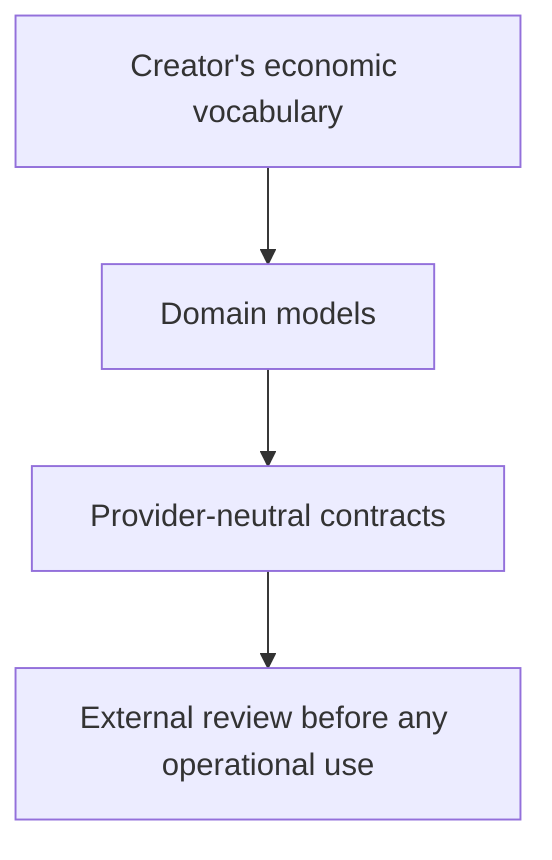

# ✳️ 00 The Singularity Workshop — Economy

[](https://github.com/TrentBest/TheSingularityWorkshop.Economy/actions/workflows/dotnet-tests.yml)



> **Exploratory economic domain model and interoperability package—not a financial service.**

Economy organizes vocabulary and boundaries for possible future economic exchange while deliberately remaining incomplete and non-operational.

## 🟦 01 What

Economy organizes vocabulary and boundaries for possible future economic exchange while deliberately remaining incomplete and non-operational.

## 🟣 02 Why

This repository explores domain vocabulary and interoperability rather than providing an operational financial service. Keeping that distinction visible helps readers evaluate current models without mistaking them for production systems or professional guidance.

## 🔺 03 How

Use it to examine domain concepts and interoperability assumptions, not to move money, provide financial advice, or infer regulatory readiness. Any future operationalization requires qualified professional review.

## 🟢 04 See it in a minute

The following source-checked example uses the public types defined in this repository and demonstrates a creator-defined shop. It models a fictional in-world currency (`GLD`); it does **not** execute a payment or move money.

```csharp
using TheSingularityWorkshop.Economy;

var owner = EconomyEntityId.New();

var sword = new CommerceItem(
    CommerceItemId.New(),
    owner,
    "Iron Sword",
    new Money(50m, "GLD"));

var potion = new CommerceItem(
    CommerceItemId.New(),
    owner,
    "Healing Potion",
    new Money(10m, "GLD"));

var shop = EconomyShop.Create(
    owner,
    "The Adventurer's Supply",
    new[] { sword, potion });

Console.WriteLine($"{shop.Name}: {shop.Products.Count} items");
```

Expected output:

```text
The Adventurer's Supply: 2 items
```

The sample follows the same shop/product composition exercised by [the existing tests](tests/TheSingularityWorkshop.Economy.Tests/EconomyTests.cs). The API was checked against source; this documentation change does not claim the snippet was independently compiled or run.

## 🟪 05 Documentation and theory

- **Scope and limits:** [What this package is — and is not](#what-this-package-is--and-is-not)
- **Creator shops and product references:** [EconomyShop.cs](EconomyShop.cs) and [Commerce.cs](Commerce.cs)
- **Amounts, intended transfers, and fee calculation:** [Money.cs](Money.cs), [Transfer.cs](Transfer.cs), and [FeePolicy.cs](FeePolicy.cs)
- **Provider and access boundaries:** [FinancialProvider.cs](FinancialProvider.cs) and [AccessLedger.cs](AccessLedger.cs)
- **Executable examples currently covered by tests:** [EconomyTests.cs](tests/TheSingularityWorkshop.Economy.Tests/EconomyTests.cs)
- **Build/test workflow:** [dotnet-tests.yml](.github/workflows/dotnet-tests.yml)

---

## Detailed guide

**TheSingularityWorkshop.Economy is an exploratory economic domain model and interoperability package, not a financial service.**

This package exists because economic exchange is an important part of the Workshop's eventual ecosystem. It is deliberately incomplete. It establishes vocabulary, boundaries, and experiments that can later be reviewed by qualified lawyers, accountants, financial professionals, compliance specialists, and provider teams.

The goal is **theoretical alignment before operational commitment**: when the Workshop eventually has the resources and professional guidance required to become operational, the groundwork should already be organized well enough that the transition from investment to launch is as small and deliberate as possible.

## What this package is — and is not

This is **not**:

- a bank
- a payment processor
- a wallet
- a money transmitter
- an accounting system
- legal advice
- tax advice
- a compliance certification
- a business-formation authority
- a Square, bank, card-network, or wallet SDK
- proof that any financial workflow is legally or operationally viable

The author is not a lawyer, accountant, financial institution, or regulatory authority. Nothing in this repository should be treated as an assertion that the Workshop currently satisfies financial, tax, corporate, licensing, payments, money-transmission, consumer-protection, privacy, securities, or other jurisdiction-specific obligations.

**The domain is intentionally unfinished because those obligations are not yet understood well enough to claim otherwise.**

## Why it exists now

The Workshop is being built from the technology outward.

The immediate purpose of Economy is to give us a playground for exploring how economic concepts can become a **shared language for software creators** without forcing those creators to rebuild the same commerce concepts inside every application.

An external creator should be able to build an RPG, simulation, marketplace, social world, or other application and consume this package as a neutral economic vocabulary. The creator's software can own its presentation, gameplay rules, inventory, characters, quests, and world state while interoperating with the Workshop's economic concepts.

That means an RPG should be able to describe something as simple as:

~~~text
Shop
  |
  +-- Name: Dragonforge Armory
  +-- Owner: Blacksmith Guild
  +-- Products:
       +-- Iron Sword — 50 GP
       +-- Dragon Armor — 500 GP
       +-- Repair Kit — 15 GP
~~~

The software does not need to invent a bespoke economic model merely because it contains a shop.

## Creator-defined shops and digital reflection

EconomyShop is intentionally small. It composes:

- an owner
- a shop name
- a product collection

CommerceItem supplies the economic product boundary:

- seller
- name
- price
- optional external reference
- optional Micro Bundle reference

This makes a useful **digital reflection** possible.

A creator can represent an in-world shop without requiring the Workshop to own the game's entire product database:

~~~text
RPG Experience
      |
      v
Dragonforge Armory
      |
      +-- Owner
      +-- Products
      |     +-- Dragon Armor
      |     +-- Firesteel Sword
      |     +-- Repair Kit
      |
      +-- Digital representation
            +-- URL
            +-- Micro Bundle
            +-- Experience
            +-- Marketplace
~~~

The same pattern can support an armor shop, potion shop, antiquities dealer, tavern, crafting guild, player marketplace, creator storefront, or entirely different economic structure.

**The point is not to prescribe the game. The point is to remove an unnecessary interoperability obstruction.**

## Provider-neutral by design

The core describes **economic intent and domain concepts**. It does not perform real financial operations.

A future architecture may look like:

~~~text
                         ECONOMY
                            |
                    Economic Intent
                            |
                 +----------+----------+
                 |          |          |
              Commerce    Gift       Reward
                 |          |          |
                 +----------+----------+
                            |
                     Provider Adapter
                       /    |     \\
                    Bank  Square  Future
~~~

Provider-specific requirements belong in separate adapters and infrastructure. They should not be smuggled into this neutral core.

A virtual bank branch inside an Experience is therefore a **visualization and interaction surface**, not the bank itself.

## Professional review is part of the eventual design

The eventual operational system will require professional review.

That includes, as applicable:

- corporate and business-formation counsel
- tax/accounting professionals
- payments and financial-services counsel
- privacy counsel
- regulatory/compliance specialists
- provider onboarding teams
- jurisdiction-specific licensing professionals
- security professionals
- insurance and risk professionals

The Workshop cannot responsibly determine those requirements from this package alone.

The purpose of this repository is to make the eventual review easier by keeping the concepts explicit and the boundaries clean.

**AI can help organize questions and documentation. AI cannot substitute for the professionals who must determine what is legally or financially required.**

## The funding boundary matters

There is a practical difference between designing a system and operating a regulated financial business.

Until the Workshop is sufficiently funded and has obtained the professional advice, accounts, registrations, contracts, infrastructure, insurance, provider relationships, and other requirements that ultimately prove necessary, Economy remains an architectural and experimental domain.

That is intentional.

We should use the period before operational funding to build the parts of the ecosystem that can be developed safely and freely.

## AI-assisted business formation: preparation, not authority

Profiles, ProtocolAi, and GrammarAi can eventually help turn private user information into structured questions, documents, checklists, and jurisdiction-specific research workflows.

For example:

~~~text
Private Profile information
        |
        v
Protocol / Grammar
        |
        v
Structured questions and candidate requirements
        |
        v
Jurisdiction research
        |
        v
Professional review
        |
        v
Actual filing / registration / approval
~~~

An LLM may help identify questions that should be asked or organize information for review.

It must **not** be treated as the authority that declares:

- a company legally formed
- a person licensed
- a business permitted to operate
- a payment settled
- a tax obligation satisfied
- a financial connection authorized
- a regulatory requirement fulfilled

Those are external facts requiring appropriate authoritative sources and, where necessary, qualified professionals.

## Products, creators, and marketplaces

The eventual Workshop economy should be able to connect creative work and physical objects to meaningful economic representations.

A photograph of something being sold should be able to become more than a paragraph of classified-ad text:

~~~text
Capture
   |
   v
Product representation
   |
   +-- URL
   +-- Micro Bundle
   +-- Experience
   +-- Marketplace
   |
   v
Economic offer
~~~

Economy should describe the exchange boundary without becoming the entire product/content database.

Creators should eventually be able to define their own storefronts, marketplaces, experiences, and representations, subject to whatever real-world requirements apply to the activity.

## User-generated value

The eventual vision includes many forms of creator and user value:

- creator sales
- marketplace sales
- royalties
- tips
- gifts
- donations
- grants
- advertising participation
- rewards
- subscriptions
- services
- licensing
- compensation
- other legitimate forms of value exchange

The domain should not assume that only conventional purchases matter.

Likewise, the Workshop's eventual platform allocation should be a **business policy subject to professional review**, not a hard-coded entitlement of this package. A stated goal of taking as little as reasonably necessary is a design philosophy, not a present financial promise.

## Sovereignty

A connected bank or payment account is not the user's Workshop identity.

Users should eventually control which external financial relationships they establish and what the Workshop is permitted to do with them.

The Economy boundary therefore separates:

- economic identity
- Workshop profiles
- external financial connections
- economic intents/transfers
- access records
- allocation policy

No external credentials belong in this repository.

## Status

**Exploratory alpha.**

This package intentionally does not include:

- live financial provider integrations
- provider credentials or secrets
- real payment execution
- banking or money-transmission claims
- business-license automation
- legal determinations
- accounting determinations
- production settlement
- compliance certification

The next useful work is **not necessarily more Economy code**. The domain should remain available as an interoperability playground while higher-value, non-financial foundations—especially Profiles and identity—are developed.

When the Workshop eventually has the resources and professional guidance to operationalize financial functionality, this repository should provide a cleaner starting point for that review rather than pretending that review has already happened.
