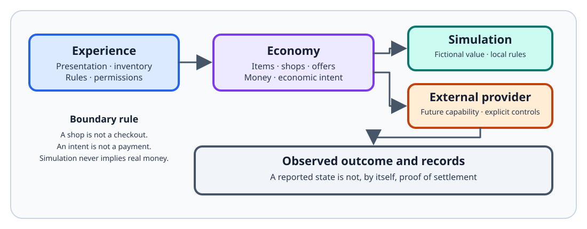

<!-- The Singularity Workshop moniker -->
<p align="center"><a href="https://github.com/TrentBest"></a></p>

# ✳️ 00 The Singularity Workshop — Economy

[](https://opensource.org/licenses/MIT)
[](https://www.nuget.org/packages/TheSingularityWorkshop.Economy)
[](https://www.nuget.org/packages/TheSingularityWorkshop.Economy)
[](https://github.com/TrentBest/TheSingularityWorkshop.Economy/actions/workflows/dotnet-tests.yml)

<p align="center">
  
</p>

**Economy is an exploratory, provider-neutral domain package for describing exchange in simulated worlds and creator commerce. It is not a financial service.**

## 🟦 01 What

Economy gives an Experience shared concepts for money-like values, products, shops, offers, transfer intent, a typed fictional-currency identity, and a process-local simulation ledger with derived balances. An RPG, simulation, creator storefront, or marketplace can reuse this vocabulary without handing over its UI, inventory, or world rules.

The first major proving ground is **Singularity City**: a simulated economy populated by Digitens, with businesses and creator-owned shops that can eventually be reused, reskinned, and composed into different Experiences. In-world economic behavior must be testable without a real-money provider.

The broader product direction is a **discoverable catalog of optional capabilities**. Developers should be able to browse the possibilities, experiment with examples, and compose only what their Experience needs—rather than adopting one giant economy. See the [Experience Capability Catalog and Composition](docs/EXPERIENCE_CAPABILITY_CATALOG.md) design.

## 🟣 02 Why

Each application can invent its own shop and offer models, but those models are harder to reuse together. Economy explores a small shared language so an Experience can describe an economic concept once and retain control over its own rules and presentation.

## 🩵 03 How

Keep four things distinct: **offer, intent, execution, and outcome**. A shop is not a checkout; a transfer intent is not a payment; a reported outcome is not automatically proof of settlement.

Simulation is intended to work without a payment provider. Real-money execution is a separate future capability requiring explicit policy, provider-specific integration, secure operations, reconciliation, and professional review. See the [architecture guide](docs/ARCHITECTURE.md) for what exists now and what remains proposed.

## 🟢 04 See it in a minute

Install the package into a compatible .NET project:

```bash
dotnet add package TheSingularityWorkshop.Economy
```

This source-checked example models a shop using fictional in-world currency `GLD`; it does not execute a payment or move money.

```csharp
using System;
using TheSingularityWorkshop.Economy;

var owner = EconomyEntityId.New();

var sword = new CommerceItem(
    CommerceItemId.New(), owner, "Iron Sword", new Money(50m, "GLD"));
var potion = new CommerceItem(
    CommerceItemId.New(), owner, "Healing Potion", new Money(10m, "GLD"));

var shop = EconomyShop.Create(owner, "The Adventurer's Supply", new[] { sword, potion });
Console.WriteLine($"{shop.Name}: {shop.Products.Count} items");
```

Expected output:

```text
The Adventurer's Supply: 2 items
```

The example follows the shop/product composition covered by the [domain tests](tests/TheSingularityWorkshop.Economy.Tests/EconomyTests.cs). It has been checked against current source but has not been independently compiled or run as a standalone sample.

## 🟪 05 Available documentation and theory

- [Experience Capability Catalog and Composition](docs/EXPERIENCE_CAPABILITY_CATALOG.md) — the toy-store model, optional capability selection, narrative economies, shared transaction workflows, and regional competition data.
- [Markets and economic playgrounds](docs/MARKETS_AND_PLAYGROUNDS.md) — casino, simulated stock exchange, businesses, auctions, jobs, and supply-chain experiments.
- [Simulated economies and creator commerce](docs/SIMULATED_ECONOMIES_AND_CREATOR_COMMERCE.md) — Singularity City, Digiten-scale measurement, reusable/reskinnable creator shops, adoption, and the first vertical slice.
- [Singularity currency and casino contract](docs/SINGULARITY_CURRENCY_AND_CASINO.md) — non-redeemable in-world currency, casino chip custody, wager lifecycle, house accounting, and the first authoritative simulation slice.
- [Exploratory Economy Experiences](docs/EXPLORATORY_ECONOMY_EXPERIENCES.md) — casino back-of-house encounters, simulated camera feeds, courtesy bankroll, free transit and paid driver roles, and multiplayer building construction.
- [What is Economy?](docs/WHAT_IS_ECONOMY.md) — build the conceptual model and understand the intended boundary without starting from API details.
- [Economy architecture](docs/ARCHITECTURE.md) — inspect current types, ownership boundaries, and the proposed path from simulation to any future provider-backed operations.
- [Shop connectors](docs/SHOP_CONNECTORS.md) — optional provider adapters, stable imported identities, declared capabilities, and current limits.
- [Economic ontology and composable models](docs/ECONOMIC_ONTOLOGY_AND_COMPOSABLE_MODELS.md) — the theory/ontology/policy/execution distinction, composable currency aspects, Simoleans example, and optional MicroBundle boundary.
- [Game store patterns](docs/GAME_STORE_PATTERNS.md) — current API examples and Experience-owned store rules.
- [Getting started](docs/GETTING_STARTED.md) — create a first shop and understand exactly what the current API does and does not do.
- [Economy theory learning path](docs/THEORY/README.md) — study value, scarcity, exchange, incentives, and the limits of economic models.
- [Economic ontology and composable models](docs/ECONOMIC_ONTOLOGY_AND_COMPOSABLE_MODELS.md) — understand the economic vocabulary and how creators can select coherent model aspects.
- [Gallery](docs/GALLERY.md) — inspect the source-backed creator-shop composition proof and its boundaries.
- [API reference index](docs/API/README.md) and [UML coverage index](docs/UML/README.md) — navigate the public type inventory and structural evidence.
- [Documentation index](DOCUMENTATION_INDEX.md) — navigate the source, tests, and workflow by task.
- [Domain tests](tests/TheSingularityWorkshop.Economy.Tests/EconomyTests.cs) and [execution-result tests](tests/TheSingularityWorkshop.Economy.Tests/EconomicExecutionResultTests.cs) — inspect the invariants currently exercised.
- [Build and test workflow](.github/workflows/dotnet-tests.yml) — see the automated restore, build, test, and package-content verification.
- [Pages preview workflow](.github/workflows/pages-build.yml) — build and upload the documentation site artifact without deploying it.

## Ecosystem fit and status

Economy should remain independently useful. Workshop experiences may compose it with other contracts, but no Workshop package is required just to describe a shop or an economic concept. The Experience owns its UI, inventory, gameplay rules, and execution policy.

**Current status: exploratory alpha.** The package does not provide a production storefront, cart, inventory system, durable or distributed ledger, payment processor, wallet, settlement service, live provider adapter, or compliance determination. The current SimulationLedger is an in-memory, process-local journal for explicit fictional-currency issuance, transfers, and retirement; it is not persistent casino custody or a production transaction service. Creator workflows and near-term revenue models remain hypotheses to validate, not implemented capabilities or promises of income. Real-money integration is deliberately separate from proving the simulated economy.

---

<p align="center">
  <a href="https://github.com/TrentBest/TheSingularityWorkshop.Economy">Economy source</a>
  ·
  <a href="https://github.com/TrentBest">The Singularity Workshop on GitHub</a>
</p>

<!-- THE SINGULARITY WORKSHOP FOOTER -->
<p align="center"></p>
