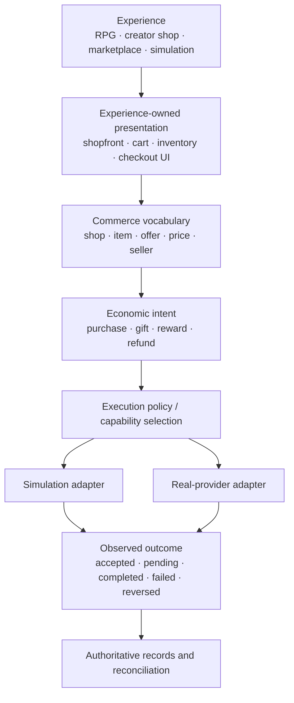

# Economy architecture: simulated worlds and real commerce

> Status: design guide for the exploratory alpha. This document distinguishes existing code from proposed boundaries; it does not declare a payment system operational or compliant.

## The design goal

An Experience should be able to add Economy and describe economic activity without having to implement a new economic vocabulary for every world.

The same core should support:

- **Simulated economies** — RPG shops, rewards, crafting markets, fictional currencies, NPC merchants, player-to-player exchange, and economic experiments.
- **Creator commerce** — storefronts for physical goods, digital goods, services, subscriptions, tips, gifts, royalties, and marketplace offers.
- **Real-money connections** — future provider-backed operations, introduced only through explicit adapters and operational controls.

These are not three different economic models. They are different execution environments around shared domain concepts. A simulation must not need a payment provider; a real-money adapter must not redefine what a shop, item, offer, or intended exchange means.

## The boundary map



The diagram is a **target architecture**, not a claim that these components all exist today. The current repository contains domain primitives, a provider interface, and an explicit execution-observation value; it does not yet provide this complete transaction lifecycle, ledger, reconciliation service, or checkout.

## What exists today

The current public surface includes:

| Existing type | Current responsibility | Important limit |
|---|---|---|
| `Money` | Decimal amount and normalized three-letter currency/unit code; same-code addition and subtraction | Not an exchange-rate service, tax calculator, or currency registry |
| `CommerceItem` | Seller, name, price, optional external URL and MicroBundle reference | Not a full product catalog, stock system, shipping record, or license |
| `EconomyShop` | Owner, name, immutable snapshot of product references | Not a hosted storefront, cart, inventory, or checkout |
| `MarketplaceOffer` | Item, marketplace identity, and creation timestamp | Not an order, acceptance, or settlement |
| `EconomyTransfer` | Validated description of intended value movement | Not evidence that anything moved |
| `EconomyAccount` | Owner and currency boundary | Does not hold or calculate a balance |
| `FeePolicy` | Explicit platform-share calculation | Does not collect, distribute, or account for fees |
| `IFinancialProvider` | Early provider abstraction for connection and execution | Its current return type is an `EconomyTransfer`, so it cannot by itself express a reliable provider outcome |
| `EconomicExecutionResult` | Immutable observation linking an operation, transfer intent, reporting environment, status, timestamp, and optional external reference | A value contract only: it does not execute operations, enforce idempotency, verify provider messages, maintain balances, or establish settlement |

See the implementations in [Commerce.cs](../src/TheSingularityWorkshop.Economy/Commerce.cs), [EconomyShop.cs](../src/TheSingularityWorkshop.Economy/EconomyShop.cs), [Money.cs](../src/TheSingularityWorkshop.Economy/Money.cs), [Transfer.cs](../src/TheSingularityWorkshop.Economy/Transfer.cs), [EconomyAccount.cs](../src/TheSingularityWorkshop.Economy/EconomyAccount.cs), [FeePolicy.cs](../src/TheSingularityWorkshop.Economy/FeePolicy.cs), [FinancialProvider.cs](../src/TheSingularityWorkshop.Economy/FinancialProvider.cs), [EconomicExecutionResult.cs](../src/TheSingularityWorkshop.Economy/EconomicExecutionResult.cs), and [AccessLedger.cs](../src/TheSingularityWorkshop.Economy/AccessLedger.cs).

## The four words we must not collapse

A safe design keeps these meanings distinct:

1. **Offer** — what a seller makes available, under stated terms.
2. **Intent** — what a participant requests or agrees should happen.
3. **Execution** — an adapter or simulation attempts the requested operation.
4. **Outcome / record** — what the system can substantiate after execution and reconciliation.

Creating a `CommerceItem`, `MarketplaceOffer`, or `EconomyTransfer` must never imply that a buyer has paid, that a seller has been paid, that stock was reserved, or that a provider accepted the operation.

A provider response saying “accepted” is not automatically “settled.” A network timeout is not proof of failure: the provider may have completed the operation while the response was lost. That is why real execution needs stable operation identity, idempotency, explicit states, and reconciliation rather than a method that simply returns the original intent.

## Simulation is a first-class execution environment

A simulated economy should be useful without accounts at a bank, payment credentials, network access, or a real-money provider.

An Experience should be able to define its own:
- currencies or value units, such as fictional `GLD`;
- rules for earning, spending, gifting, trading, or rewarding;
- shop inventory and price changes;
- limits, taxes, fees, crafting costs, or scarcity;
- deterministic test scenarios and resettable world state.

These rules belong to the Experience or its chosen economic policy, not to hard-coded assumptions in the shared core. The shared package supplies interoperable concepts; it should not dictate the economy of every game or marketplace.

A future simulation adapter should explicitly identify itself as simulated and keep its records in its own simulation boundary. It must not be able to masquerade as a real provider result merely because both implement a common interface. Tests should make it easy to verify that simulated balances, fictional currency, and simulated completion never imply real payment.

## Real-money readiness is a separate capability, not a global switch

Do not make “Economy enabled” mean “real money enabled.” Adding the package to an Experience should be safe for a purely fictional shop.

A future integration should require deliberate configuration of a specific provider and permitted capabilities. A provider connection should not silently grant authority to initiate every possible operation. The Experience and its operator need to decide which actions are allowed, for whom, in what environment, and with what limits.

Before any real provider adapter is described as ready, its contract and tests need to address at least:

- **Operation identity and idempotency:** retries must not create duplicate charges or payouts.
- **Outcome states:** distinguish created, submitted, pending, succeeded, failed, cancelled, expired, and reversed where relevant; provider-specific states may need mapping without losing source detail.
- **External references:** preserve provider operation IDs and correlation IDs without treating them as secrets.
- **Asynchronous events:** validate provider webhooks/events, handle duplicate and out-of-order delivery, and reconcile against provider records.
- **Refunds, disputes, chargebacks, and reversals:** represent later changes instead of rewriting history as if the first result never happened.
- **Amounts and rounding:** define precision, minor units, rounding policy, and provider constraints explicitly. A generic decimal alone is not enough to encode every provider's rules.
- **Authorization and consent:** keep account connection, permission to read, permission to initiate, and permission to pay out distinct.
- **Secrets and personal data:** credentials belong in a secure integration boundary, never in domain objects, manifests, examples, or source control.
- **Auditability:** distinguish a request, provider response, verified event, and reconciled record.
- **Operational safeguards:** sandbox/live environment separation, limits, monitoring, incident handling, and professional review appropriate to the actual product and jurisdictions.

This is an engineering checklist, not a determination of legal, tax, licensing, or compliance requirements. Those must be assessed by qualified professionals and the selected providers before real operation.

## A sensible layering

Keep the shared domain provider-neutral and let Experiences compose capabilities around it.

| Layer | Owns | Should not own |
|---|---|---|
| Economic vocabulary | IDs, amounts, offers, intent types, domain constraints | UI, provider credentials, HTTP calls |
| Experience policy | Game rules, shop rules, access policy, allowed actions | Hidden global assumptions about every Experience |
| Simulation adapter | Deterministic simulated execution and simulation records | Claims about real payment |
| Provider adapter | Provider-specific requests, authentication, external IDs, event mapping | Redefinition of shared domain vocabulary |
| Transaction orchestration | Idempotency, lifecycle, retries, outcome mapping, reconciliation coordination | Treating an unverified response as final settlement |
| Experience presentation | Storefront, cart, inventory visuals, checkout flow | Claiming an operation succeeded without authoritative outcome |

The architecture can evolve incrementally. It does not require adding every layer to the alpha package immediately. In particular, keep provider SDKs out of the core dependency graph.

## Suggested implementation sequence

The domain vocabulary and first result value contract now exist. The remaining steps are proposed work, not existing capabilities.

1. **Lock down the domain vocabulary.** Continue documenting what each current type guarantees and what it deliberately does not guarantee. Keep tests focused on those invariants.
2. **Define the lifecycle and idempotency boundary.** Decide who creates operation IDs, who owns retry safety, and how uncertain outcomes are recovered. The current result's operation ID is descriptive; it does not implement idempotency.
3. **Build a simulation adapter first.** Exercise accepted, pending, failed, duplicate request, timeout/unknown, and reversal scenarios without any real money. Make the simulated nature explicit and keep simulated balances/records inside the simulation boundary.
4. **Define records and reconciliation.** Model immutable observations and corrections so asynchronous provider events and reversals do not erase history. Do not call a simple account object a ledger.
5. **Add one sandbox provider adapter only after the lifecycle contract is stable.** Keep provider implementation in a separate package/repository boundary where practical. Use the provider's test environment and test credentials, not live money.
6. **Add operational and professional review before live use.** Security review, provider approval, jurisdiction-specific advice, monitoring, incident procedures, and explicit launch authorization remain outside what a domain library can certify.

## Example: one storefront, two execution environments

The same Experience-owned catalog can be rendered as a fantasy merchant or as a creator's storefront:

```text
Experience
  └─ Economy shop
      ├─ Owner: creator / guild / seller
      ├─ Item: "Iron Sword" or "Handmade Ceramic Cup"
      ├─ Price: 50 GLD or 35 USD
      └─ Offer
          ├─ Simulation policy → update simulated world records
          └─ Real provider policy → request a provider operation
                                  → verify outcome
                                  → reconcile records
```

The example describes the intended composition, not a current checkout API. An Experience owns its product details and presentation. Economy gives it shared economic vocabulary. The selected execution environment determines whether value is fictional or real, and the system must preserve that distinction in its records and user-facing language.

## Readiness statement

The repository is an exploratory alpha. Its current models are useful foundations for shared vocabulary, creator-defined shop composition, and provider-neutral design. They are **not yet a production commerce platform or real-money integration**.

The right goal is not to rush a payment SDK into the core. It is to make the boundary between economic meaning, execution, and verifiable outcome so clear that simulated economies remain lightweight and real-money integrations can be added deliberately without corrupting the shared model.
