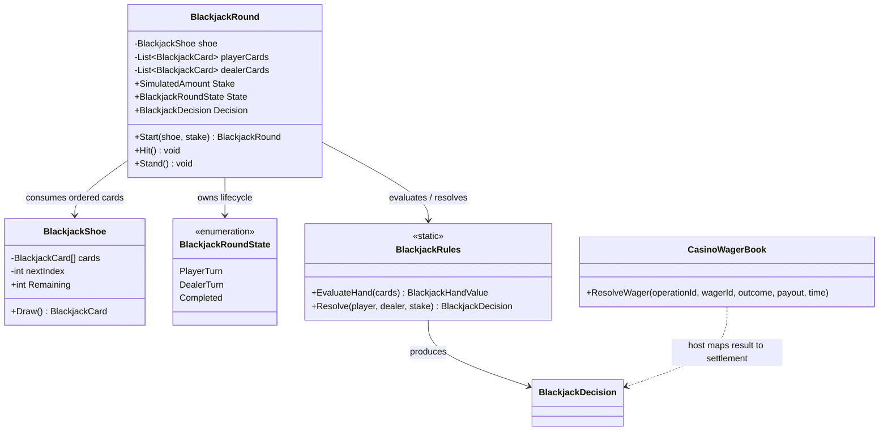
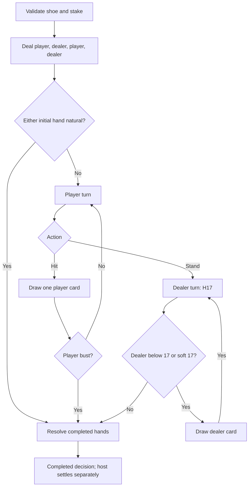

# BlackjackRound — structure and lifecycle

## 01 — What

This view documents the deterministic shoe and round coordinator. Public type relationships are source-derived; the lifecycle narrative is authored from the implementation contract.

## 02 — Why

The engine makes card order and action transitions explicit without absorbing randomization, persistence, presentation, or accounting. The same ordered shoe can reproduce the same round in tests.

## 03 — How

### Type neighborhood

### Round activity

### Invariants and limits

- Card order is an input, not generated state. There is no implicit random source.
- The first implementation represents one standard deck and rejects repeated rank/suit identities.
- The dealer follows hit-soft-17 (H17), not a configurable table policy.
- A player bust resolves immediately; the dealer's initial two cards are sufficient for the rules evaluator.
- Dealer shoe exhaustion preserves partial dealer progress and leaves the round in DealerTurn.
- A completed decision is not a ledger posting. The host separately calls CasinoWagerBook with an operation ID.
- Shoe and round state are volatile and not safe for crash recovery or distributed play.

## 04 — See it in a minute

Executable lifecycle evidence: [BlackjackRoundTests.cs](https://github.com/TrentBest/TheSingularityWorkshop.Economy/blob/development/tests/TheSingularityWorkshop.Economy.Tests/BlackjackRoundTests.cs). Implementation: [BlackjackRound.cs](https://github.com/TrentBest/TheSingularityWorkshop.Economy/blob/development/src/TheSingularityWorkshop.Economy/BlackjackRound.cs).

## 05 — Choose your next step

- Add multi-deck card identity and table-configurable dealer policy.
- Add round-to-wager integration tests with stable caller-owned operation IDs.
- Design durable round snapshots and shoe provenance before multiplayer or restart-recovery claims.

<!-- THE SINGULARITY WORKSHOP FOOTER -->

