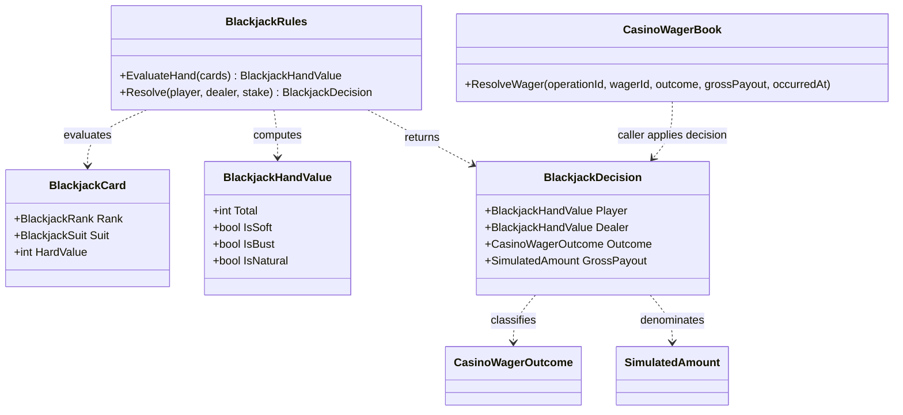
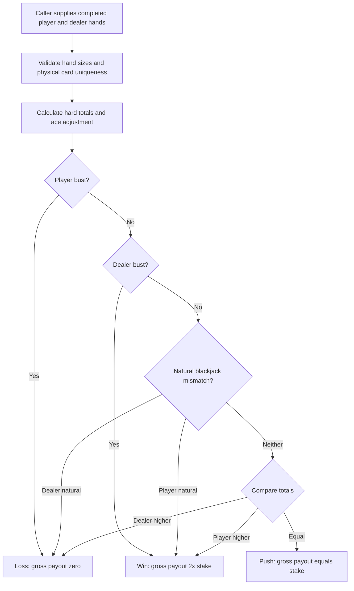

# Blackjack rules — deterministic evaluation and settlement contract

## 01 — What

The blackjack rules slice is a pure evaluator over caller-supplied physical cards. It converts completed player and dealer hands plus a typed simulated stake into a BlackjackDecision.

It does not own a shoe, shuffle, draw cards, accept player actions, generate randomness, or write to SimulationLedger.

## 02 — Why

Game rules must be reproducible independently of economic accounting. A retry or replay must not silently produce a different hand because the accounting layer generated a new random outcome. The caller supplies the complete card state; the rules layer derives hand values and a settlement instruction.

The initial payout policy is intentionally narrow: a win pays even money (gross payout equals twice the stake, including returned stake); a push returns the stake; a loss pays zero. Natural blackjack wins against an ordinary 21 but does not receive a bonus payout in this first rules version.

## 03 — How

### Type neighborhood



### Decision flow



### Invariants

- A completed round has at least two cards in each hand.
- A physical card (rank and suit) appears at most once across both hands.
- Aces count as eleven only when the hand remains at or below 21; otherwise they count as one.
- A natural is exactly two cards totaling 21.
- A player bust loses even if the dealer also busts.
- A dealer bust wins only when the player has not busted.
- Payout is an instruction, not a ledger mutation. The caller passes the decision to CasinoWagerBook.ResolveWager with its own stable operation ID.

## 04 — See it in a minute

```csharp
var decision = BlackjackRules.Resolve(
    playerCards,
    dealerCards,
    new SimulatedAmount(10m, currency.Id));

wagerBook.ResolveWager(
    resolutionOperationId,
    wagerId,
    decision.Outcome,
    decision.GrossPayout,
    occurredAt);
```

The supplied card lists are the deterministic input. Persisting or replaying the same lists and stake produces the same decision. The game host remains responsible for obtaining cards, enforcing action order, and recording the input sequence.

## 05 — Choose your next step

- Read the blackjack rules API in docs/API/SimulationLedger.md.
- Read the casino accounting contract in CasinoWagerBookUML.md.
- Follow issue #14 for the remaining simulation-only casino work.

### Explicit limits

No shuffle or random source, draw/shoe lifecycle, hit/stand state machine, dealer soft-17 policy, split/double/insurance, table limits, natural bonus payout, durable round history, or user interface is implemented. These are separate design decisions and must not be implied by this evaluator.

<!-- THE SINGULARITY WORKSHOP FOOTER -->
<p align="center"></p>
