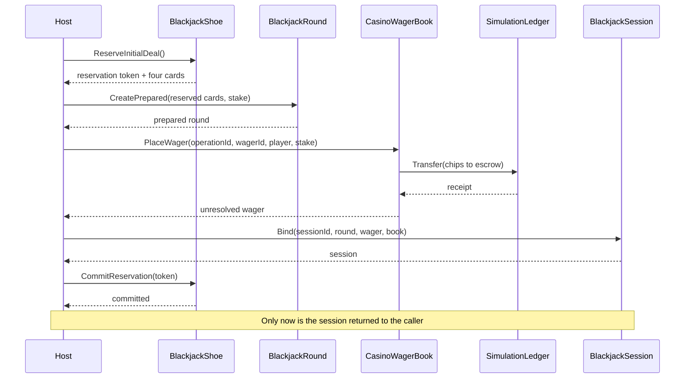

# Blackjack session opening UML

## 01 — What

Session opening is the host-owned boundary that turns a proposed blackjack round into a wager-backed session. It must coordinate two independent process-local resources: the ordered shoe and the simulated-currency ledger/wager book.

This document defines the safe opening protocol and its current guarantees. It does not claim a distributed transaction across the shoe and ledger.

## 02 — Why

The naive ordering has two failure modes:

- Place the wager, then deal: a deal/session construction failure can leave the stake in escrow without a usable session.
- Deal, then place the wager: a rejected/failed wager consumes cards from the shoe.

A refund-style compensation is not an adequate generic fix. It can fail, race with other ledger activity, or obscure whether a wager was already settled. The opening protocol must make resource ownership and the remaining failure window explicit.

## 03 — How

### Required staged protocol

1. Validate all caller-supplied identities, stake positivity/precision, shoe availability, and host composition arguments before moving value.
2. Reserve the first four cards as a private, non-consumable shoe reservation. While reserved, the shoe rejects other draws and reservations.
3. Construct the round from the reserved deal without advancing the committed shoe cursor.
4. Place the wager through CasinoWagerBook. The ledger transfer remains the sole authority for stake movement.
5. Bind the resulting wager snapshot and prepared round into BlackjackSession.
6. Commit the shoe reservation only after the session has been constructed successfully.
7. If wager placement fails, release the reservation without consuming cards.

### Sequence

### Failure and atomicity contract

- Validation or reservation failure occurs before ledger movement.
- Wager placement failure releases the reservation; the shoe cursor remains unchanged.
- The shoe reservation is exclusive within that shoe instance. It prevents concurrent draws from invalidating rollback.
- The ledger transfer is still independently atomic inside SimulationLedger.
- There is no true atomic commit spanning the shoe and ledger. A process crash after the wager transfer but before the session is returned can still leave an unresolved escrowed wager and an uncommitted in-memory reservation. Both resources are volatile, so process termination discards the reservation but does not make the ledger durable.
- The factory must not silently refund or settle a wager as a generic catch block. Recovery must use an explicit wager cancellation/reversal operation with its own idempotency key, or a durable transaction coordinator, neither of which is currently implemented.
- A shoe is single-owner while a reservation is outstanding. Sharing one shoe across independently active sessions remains unsupported.

### Deliberate non-goals

This opening protocol does not add random shuffling, shoe persistence, durable session recovery, multiplayer concurrency, table authorization, or real-money/payment behavior. All credits remain non-redeemable simulation value.

## 04 — See it in a minute

The current `BlackjackSession` constructor binds an already-created round and already-placed wager. It detects mismatched or externally changed wager state, but does not own opening or repair a failed host composition.

The staged protocol above is the implementation target. Until the reservation and opening API exist, hosts must treat wager placement followed by round/session construction as a failure-sensitive sequence and explicitly reconcile any orphaned unresolved wager.

## 05 — Choose your next step

- Implement exclusive shoe deal reservations with commit/release semantics.
- Add one host-facing session-opening factory that prepares the round before moving the stake.
- Add failure-injection tests proving a failed wager placement leaves the shoe cursor unchanged.
- Define an explicit idempotent wager cancellation/reversal contract before claiming recovery from failures after value movement.
- Add durable transaction coordination only when persistence is introduced; do not simulate durability with in-memory flags.

<!-- THE SINGULARITY WORKSHOP FOOTER -->

