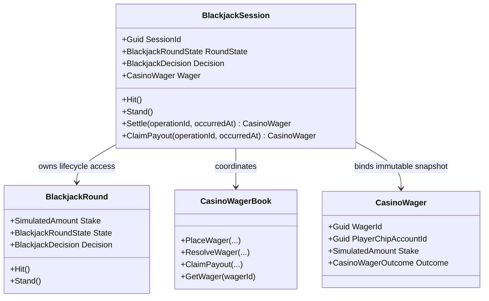
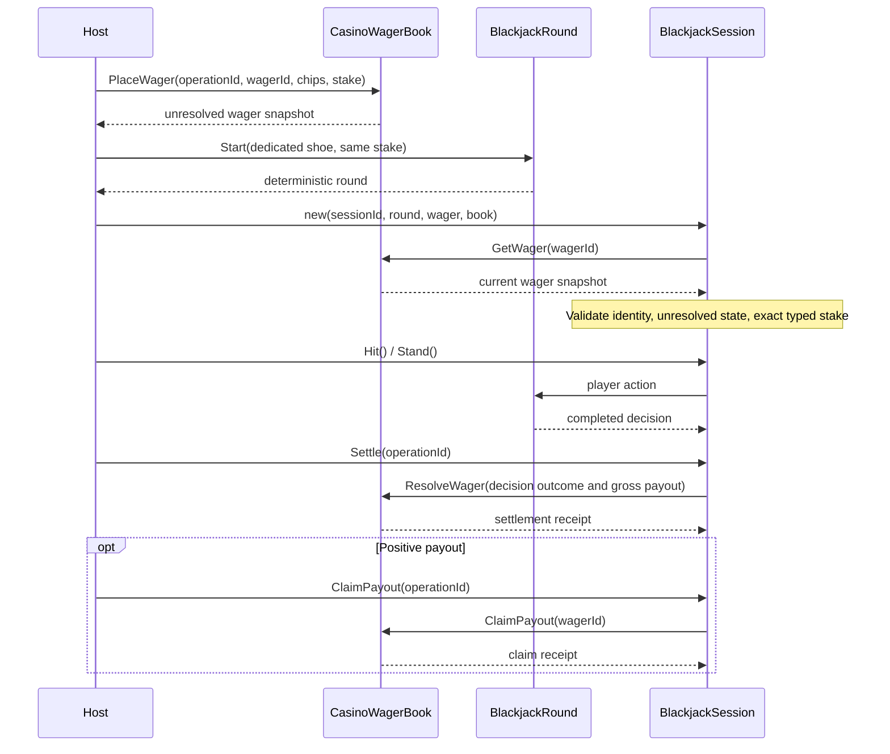

# Blackjack session UML

## 01 — What

**BlackjackSession** is a process-local host coordinator that binds one unresolved **CasinoWager** to one deterministic **BlackjackRound**. It owns the application-level path from player actions through settlement and payout claim.

## 02 — Why

The game engine and economic book deliberately have separate responsibilities. Without a session boundary, a host can accidentally settle a wager with a decision from another round, use a mismatched stake, or expose lifecycle actions in the wrong order. The session narrows that integration surface and checks the wager snapshot before each state-changing operation.

## 03 — How

### Type neighborhood

### Session flow

### Invariants and failure boundaries

- The session ID, wager ID, and wager placement operation ID must be non-empty.
- The supplied wager must be the current unresolved wager in the supplied book.
- The round's typed stake must exactly equal the wager's typed stake, including currency identity.
- A round cannot be settled until it produces a decision.
- Only the decision exposed by the bound round is passed to ResolveWager; callers do not supply an arbitrary outcome or payout to the session.
- Game actions stop after round completion or when the wager is externally resolved.
- Settlement and claim operation IDs remain caller-supplied and are idempotent through the wager book when retried exactly.
- A loss has no positive payout to claim; the wager book rejects such a claim.
- The session serializes its own calls, but does not make the round or wager book durable or distributed.

### Composition boundary

The host currently places the wager and starts the round before constructing the session. This avoids hiding value movement inside a game object, but means the host must handle composition failures. A dedicated shoe per round is required; concurrent sharing of one mutable shoe is unsupported. The session cannot recover a process crash or reconcile a partially composed host workflow.

## 04 — See it in a minute

BlackjackSessionTests cover successful win/settlement/claim and exact retries, mismatched typed stakes, stale or already-resolved wager snapshots, invalid lifecycle ordering, and settlement performed outside the session boundary. The session is a coordination layer, not a new game engine or ledger.

## 05 — Choose your next step

- Read the [API contract](../API/SimulationLedger.md#blackjack-session-coordination).
- Inspect [session tests](../../tests/TheSingularityWorkshop.Economy.Tests/BlackjackSessionTests.cs).
- Continue toward a durable session aggregate only after defining persistence, recovery, ownership, and concurrency contracts.

<!-- THE SINGULARITY WORKSHOP FOOTER -->

