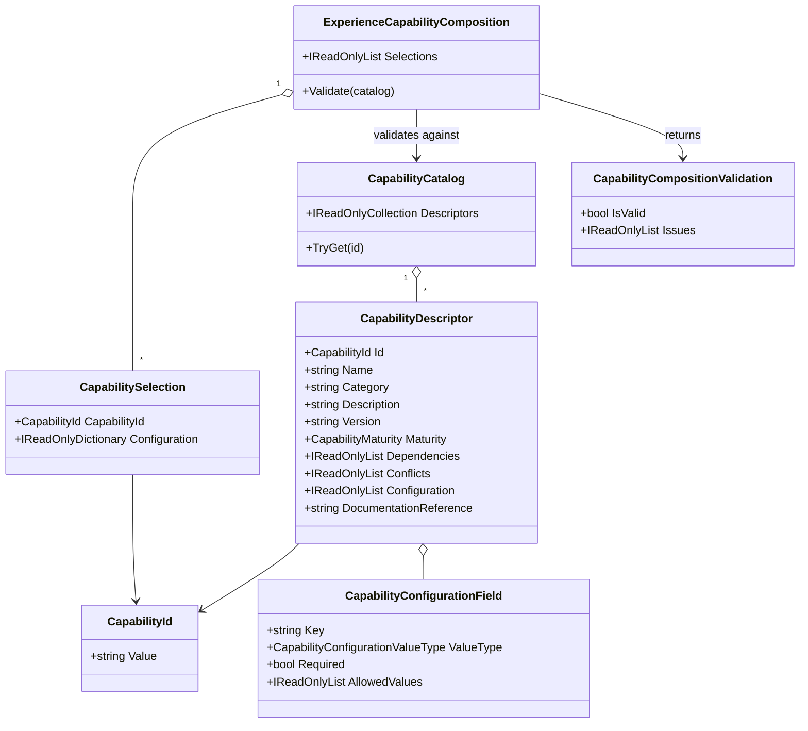
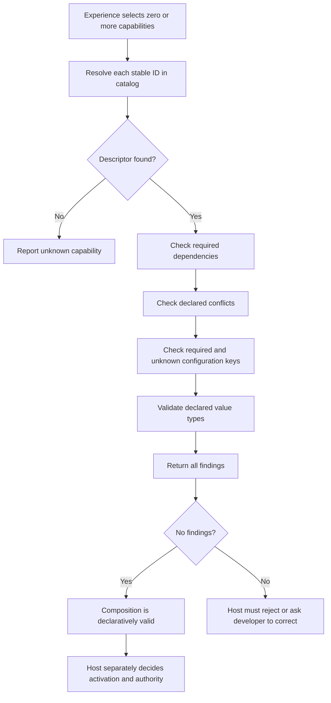

# Capability Catalog and Composition UML

**Status: implemented declarative contracts; no runtime activation or editor.**

## 01 — What

The capability catalog describes optional features an Experience can discover and select. A descriptor advertises stable identity, category, maturity, dependencies, conflicts, configuration metadata, and a documentation reference. An Experience composition holds selected descriptors and Experience-owned string configuration values.

## 02 — Why

A single package can offer a broad set of possibilities without imposing every feature on every Experience. A city simulator may select budgets and construction; an RPG may select shops and training; a tournament Experience may select competition capabilities. The composition contract makes those selections inspectable and validates their declared compatibility before a host chooses whether and how to activate anything.

## 03 — How

### Validation flow

## 04 — See it in a minute

The tests compose an optional fictional ledger capability and a shop capability that depends on it, then show that selecting only the ledger is valid while selecting the shop without the ledger is not. A second example declares mutually incompatible live-provider and simulation modes. Configuration is validated against descriptor metadata without embedding a universal editor or executing any selected capability.

See [CapabilityCompositionTests.cs](../../tests/TheSingularityWorkshop.Economy.Tests/CapabilityCompositionTests.cs) and [CapabilityComposition.cs](../../src/TheSingularityWorkshop.Economy/CapabilityComposition.cs).

## 05 — Choose your next step

- Add sample Experience manifests that select different subsets from one shared catalog.
- Define capability dependency cycles and version compatibility once descriptor version semantics are formalized.
- Add a host-owned activation protocol only when a real host integration is ready to enforce lifecycle, permissions, and side-effect boundaries.
- Do not mistake descriptor maturity for operational authorization. No capability in this contract can initiate payments, issue fictional value, or activate itself.
