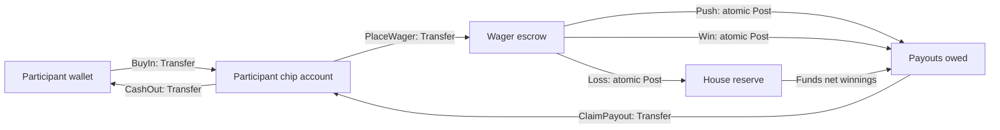
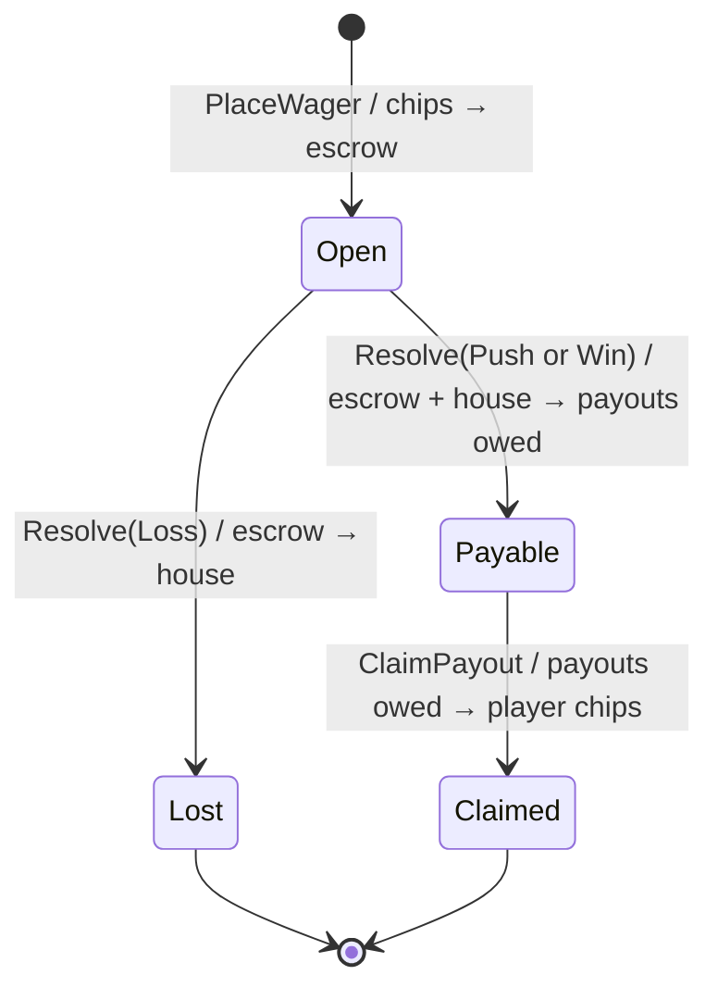

# Casino custody and wager lifecycle — UML and use cases

## 01 — System boundary

The casino accounting slice is an Economy capability. It accepts account identities, typed simulated amounts, operation IDs, timestamps, and an already-decided wager outcome. It does not own the table UI, random-number generator, game rules, participant identity, or durable storage.

All accounts use the same typed simulated currency. The cashier performs one-for-one transfers; no issuance occurs during buy-in or cash-out. A win's gross payout includes the stake returned plus net winnings, so the house reserve funds only the winnings.

## 02 — State model

A losing wager has no payable amount. A push creates a payable equal to the original stake. A win creates a payable equal to the declared gross payout, which must exceed the stake. Invalid transitions do not mutate wager state or ledger balances.

## 03 — Atomicity and idempotency

| Transition | Ledger primitive | Required operation identity |
|---|---|---|
| Buy-in / cash-out | Transfer | One caller-supplied operation ID per direction |
| Place wager | Transfer | One caller-supplied placement operation ID plus unique wager ID |
| Resolve wager | Balanced multi-account Post | One caller-supplied resolution operation ID |
| Claim payout | Transfer | One caller-supplied claim operation ID |

Each operation is atomic inside the process-local ledger. CasinoWagerBook serializes its in-memory wager transitions. Exact retries return replay receipts; conflicting reuse of wager or operation identity is rejected. These guarantees do not survive process restart and do not protect against external code writing directly to the same accounts.

## 04 — Use cases

### UC-01: Buy in

1. Participant chooses an amount and cashier validates it against the participant's wallet balance.
2. Cashier transfers the amount from wallet to chip account.
3. The ledger records the debit and credit under one operation ID.
4. A retry with the same ID cannot issue a second buy-in.

### UC-02: Place a wager

1. A table/game adapter supplies a unique wager ID, player chip account, stake, and operation ID.
2. The wager book transfers the stake to escrow.
3. If the participant lacks funds or the operation is invalid, no wager snapshot is created and no ledger posting is committed.

### UC-03: Resolve a wager

1. A game rules component supplies a declared outcome and gross payout.
2. The wager book checks outcome/payout consistency.
3. Loss: escrow stake moves to house reserve.
4. Push: escrow stake moves to payouts owed.
5. Win: escrow stake and house-funded net winnings move atomically into payouts owed.
6. The wager snapshot stores the outcome and receipt.

### UC-04: Claim payout

1. The participant claims a resolved positive payable.
2. The wager book transfers that exact amount from payouts owed to the player's chip account.
3. A repeated claim with the same operation ID replays; a different second claim is rejected.

## 05 — Known limits and next work

- The ledger and wager book are process-local and volatile.
- No durable journal, restart recovery, distributed transaction, or reconciliation protocol exists.
- The current book has no game-rule engine, RNG, payout table, betting limits, station capacity, or dealer workflow.
- There is no separate chip currency: chips are the participant's in-world simulated-currency account.
- The shared payouts-owed account is protected only when transitions go through this book; direct external ledger writes can interfere.
- The receipt's aggregate amount remains decimal-bounded as documented in the ledger API.

<!-- THE SINGULARITY WORKSHOP FOOTER -->

