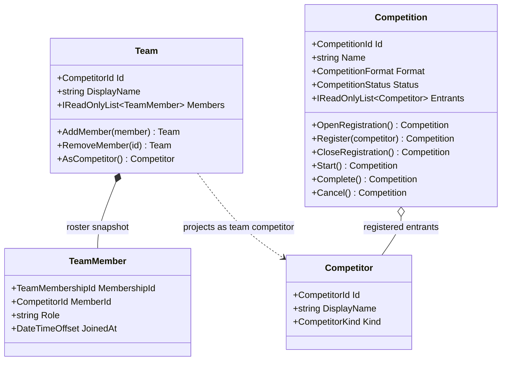
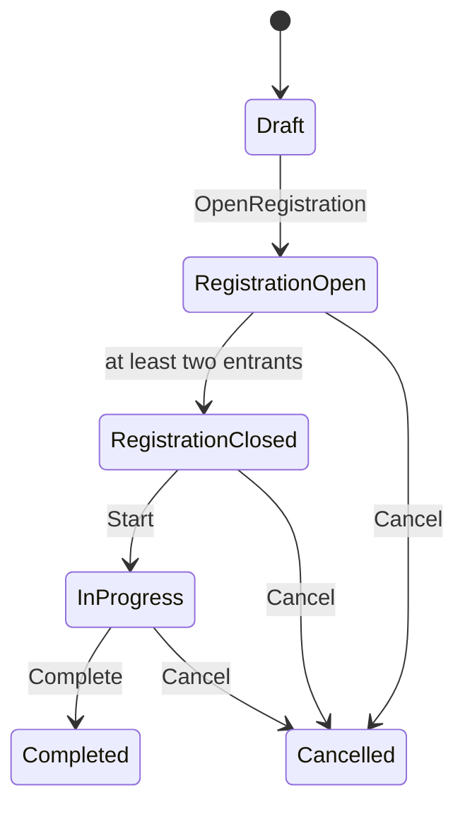

# Competition and team primitives

## 01 — What

The competition foundation introduces provider-neutral identities for competitors, teams, and organized competitions. A competitor can be an individual or an assembled team. A team owns a versioned roster snapshot through immutable membership operations. A competition owns an immutable registration snapshot and a guarded lifecycle.

These primitives are intended to support sports, esports, poker tables, blackjack tournaments, creator challenges, fantasy/dream teams, guilds, and other organized activities without making the core economy depend on any particular game.

## 02 — Why

A competition platform must not assume that every participant is one person or that every event is a single match. A team may be a real-world squad, a fantasy roster assembled from athletes, a group of creators, or a temporary team formed for one event. Competition format is also independent of activity rules: a poker tournament and an esports tournament can share tournament administration while using entirely different rules engines.

The first implementation deliberately separates identity and registration from scheduling, scoring, and payouts. That prevents a shallow Tournament class from pretending to implement brackets, standings, or match adjudication before those contracts exist.

## 03 — How

### Type neighborhood



### Registration lifecycle



### Contracts exercised by tests

- IDs and display names must be valid; enum values must be defined.
- A team cannot contain duplicate membership IDs or duplicate member identities.
- Team changes return a new team snapshot and leave the prior snapshot unchanged.
- A competitor can register once in a competition.
- Registration is capacity-limited when a maximum is supplied.
- Only an open registration accepts entrants; closing requires at least two entrants.
- Competition lifecycle transitions are explicit and return new snapshots.
- Competition format values describe supported vocabulary; they do not claim a scheduler or bracket engine exists.

### Explicit maturity boundary

Implemented: competitor identity, individual/team kind, team roster membership, immutable roster edits, competition registration, entrant capacity, and competition lifecycle transitions.

Not implemented: tournament bracket generation, byes, round advancement, round-robin scheduling, standings, seeding policies, drafts, fantasy scoring, player statistics, roster salary caps, eligibility rules, team ownership, match adjudication, tournament entry fees, prize distribution, or persistent storage.

## 04 — See it in a minute

```csharp
var team = new Team(CompetitorId.New(), "Dream Team")
    .AddMember(new TeamMember(
        TeamMembershipId.New(),
        athleteId,
        "forward",
        DateTimeOffset.UtcNow));

var competition = new Competition(
        CompetitionId.New(),
        "Workshop Cup",
        CompetitionFormat.SingleElimination,
        maximumEntrants: 16)
    .OpenRegistration()
    .Register(team.AsCompetitor());
```

The code creates a team and registers it as one competitor. The competition does not need to know whether the team is a sports squad, an esports roster, or a fantasy lineup.

## 05 — Choose your next step

- Add explicit tournament instances, seedings, bracket slots, and deterministic advancement.
- Add fantasy roster policies: eligible player pool, positions, roster size, draft, lock time, and scoring rules.
- Add league/season scheduling and standings as separate policies.
- Connect match results to prediction markets only after event identity and result provenance are defined.

<!-- THE SINGULARITY WORKSHOP FOOTER -->
<p align="center"></p>
