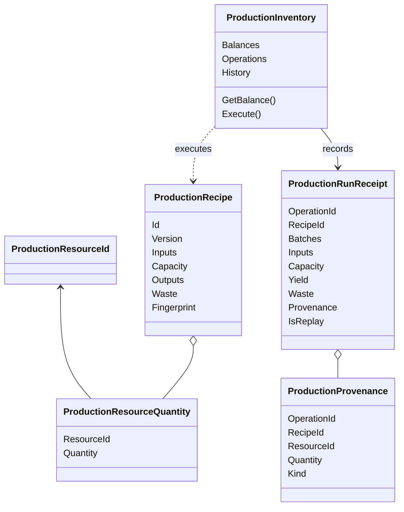

# Production capability — contract and execution flow

## 01 — What

This view documents the implemented process-local production contract. It is source/test-backed, not a claim of durable production scheduling or a physical manufacturing system.

## 02 — Why

The shared economic kernel should apply common inventory invariants while Experiences supply resource identities, recipes, and world-specific policy. The engine does not know what a barracks, farm, forge, or shipyard means.

## 03 — How

### Type neighborhood



### Execution sequence

```mermaid
sequenceDiagram
    participant Host as Experience / Host
    participant Inventory as ProductionInventory
    participant Recipe as ProductionRecipe
    Host->>Inventory: Execute(operationId, recipe, batches, time)
    Inventory->>Inventory: Validate operation identity
    alt Operation already applied
        Inventory-->>Host: Replay receipt
    else New operation
        Inventory->>Recipe: Read immutable resource declarations
        Inventory->>Inventory: Scale all quantities with checked arithmetic
        Inventory->>Inventory: Calculate net resource deltas
        Inventory->>Inventory: Validate every resulting balance
        alt Any balance would be negative
            Inventory-->>Host: Reject; no state mutation
        else All invariants pass
            Inventory->>Inventory: Commit balances, receipt, provenance, history
            Inventory-->>Host: Completed production receipt
        end
    end
```

### Invariants

1. Inputs and capacity decrease inventory.
2. Yield and waste increase inventory as separately classified outputs.
3. All scaled quantities and resulting balances validate before any mutation.
4. The operation ID identifies one recipe definition and batch count within this inventory instance.
5. An identical replay cannot apply the same production a second time.
6. A failed attempt does not create a receipt or mutate balances.
7. Every declared resource flow is represented in receipt provenance.

## 04 — Limits

- In-memory, process-local state only; no persistence or distributed atomicity.
- No production scheduling, queue, machine locking, workforce assignment, or time-based capacity reservation.
- No variable-yield process model or external measurement verification.
- No automatic account credit, sale, reward, or currency issuance.
- Hosts retain authorization and world-specific policy.

## 05 — Evidence

- [Production implementation](../../src/TheSingularityWorkshop.Economy/Production.cs)
- [Production tests](../../tests/TheSingularityWorkshop.Economy.Tests/ProductionTests.cs)
- [Production API reference](../API/Production.md)

<!-- THE SINGULARITY WORKSHOP FOOTER -->
<p align="center"></p>
