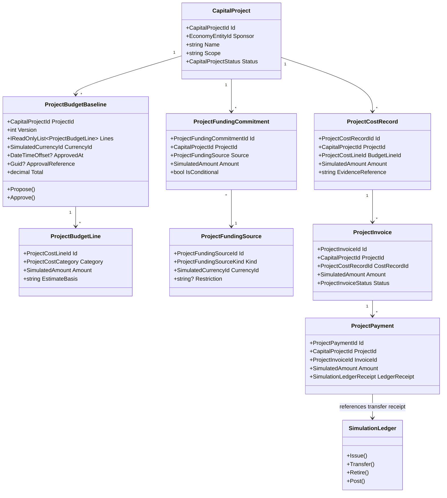

# Project finance domain neighborhood

**Status: current vocabulary view; not a complete workflow or authorization diagram.**

## Boundary rules

- A funding commitment is not cash received.
- A budget baseline is not spending authority by itself.
- A cost record is not an invoice or payment.
- An invoice is not proof of payment.
- A payment references an existing simulated ledger transfer; it does not initiate one.
- Estimates, commitments, costs, and invoices do not create ledger postings.
- Project-specific identity, authorization, persistence, and presentation belong to the host/Experience.
