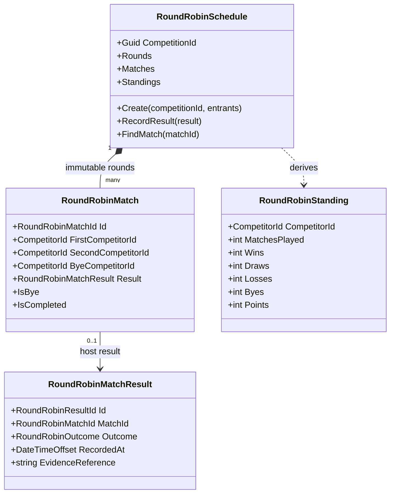

# Round-robin schedule and standings contract

## Purpose

`RoundRobinSchedule` creates a deterministic, immutable schedule for every entrant pair. It uses the circle method: an even field plays `n - 1` rounds; an odd field adds a virtual slot and plays `n` rounds, with exactly one automatic bye in each round.

## Structural view

## Public contract

- `RoundRobinMatchId` identifies a competition, round, and match.
- `RoundRobinMatchResult` records a stable result ID, scheduled match, outcome, timestamp, and host evidence reference.
- `RoundRobinMatch` represents either a played pairing or a bye. Byes are not played matches and cannot accept results.
- `RoundRobinSchedule.Create` validates the competition identity and unique entrants, then generates all rounds in input order.
- `RecordResult` returns a new immutable schedule. Exact duplicate result submissions are idempotent; conflicting reuse of a result ID is rejected.
- `Standings` derives played, win, draw, loss, bye, and points totals from recorded results and scheduled byes.

## Points and tie-break policy

The initial policy is intentionally explicit and narrow:

1. Win: 3 points.
2. Draw: 1 point.
3. Loss: 0 points.
4. Sort by points descending.
5. Then wins descending.
6. Then competitor Guid ascending for a stable final order.

There is no head-to-head, score differential, away-goal, strength-of-schedule, or sport-specific tie-break policy. Those should be introduced as named policy inputs rather than silently inferred by this general-purpose engine.

## Evidence and authority

The host must validate the result under the activity's rules before calling `RecordResult`. Economy retains the evidence reference but does not fetch, inspect, verify, or retain the underlying evidence. ServerApp remains the orchestration boundary; activity-specific adapters own match sessions and evidence validation.

## Invariants covered by tests

- Every unordered entrant pair appears exactly once.
- Every round contains each entrant exactly once, including a bye for one entrant when the field is odd.
- Odd fields receive one bye per competitor across a complete schedule.
- Results update standings without mutating prior schedule snapshots.
- Duplicate result identity/data is idempotent; conflicting identity reuse is rejected.
- Draws award one point to each participant; byes do not award match points.

## Deliberate gaps

This is schedule generation and a basic points table, not a full league administration system. It does not allocate dates, venues, home/away policy, travel constraints, withdrawals, forfeits, score aggregation, tie-break adjudication, season lifecycle, or persistence.
