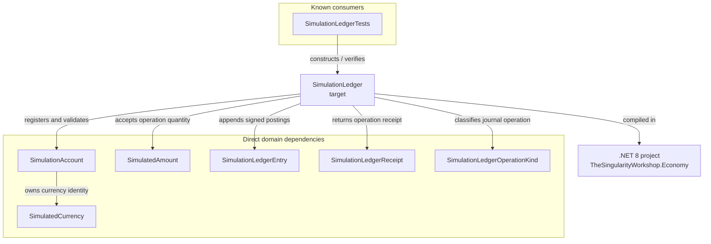

# SimulationLedger — UML neighborhood and use cases

**Evidence class:** source-derived type/member relationships with human-authored use cases.  
**Target:** SimulationLedger in development source.  
**Scope:** the Economy library and its current tests; no claim is made that this is a repository-wide dependency scan.

## 01 — What

This page centers SimulationLedger and maps the current callers, dependencies, and project boundary. The diagram is a static structural view, not a runtime trace or interactive UML editor.

## 02 — Why

The ledger is a central new domain boundary. Its neighborhood should make clear which types it consumes, which data it emits, and what its tests actually verify. It must not imply that an in-memory ledger is durable or that a ledger posting is a real-world payment.

## 03 — How

### Target-centered neighborhood

### Relationships

| Relationship | Evidence |
|---|---|
| SimulationLedgerTests constructs and exercises SimulationLedger | SimulationLedgerTests.cs |
| SimulationLedger registers SimulationAccount | RegisterAccount and account lookup |
| SimulationAccount references SimulatedCurrency | SimulationAccount constructor and Currency property |
| SimulationLedger validates SimulatedAmount against account currency and precision | EnsureCurrency |
| SimulationLedger appends SimulationLedgerEntry records | Commit |
| SimulationLedger returns SimulationLedgerReceipt records | Issue, Transfer, Retire, and GetReceipt |
| SimulationLedgerOperationKind classifies entries and receipts | Public enum and operation methods |

Private implementation detail: OperationFingerprint stores the operation kind, account IDs, and amount used to distinguish an exact retry from conflicting reuse of an operation ID. It is not public API.

### Use cases

**UC-01 — Register an account**

- Actor: simulation host or test.
- Goal: make an account available to the ledger.
- Preconditions: account has a non-empty ID, owner, and typed currency.
- Success: account is registered and its currency metadata is recognized.
- Alternatives: duplicate account ID or conflicting metadata for an existing currency ID is rejected.
- Evidence: RegisterAccount and account registration tests.

**UC-02 — Issue fictional currency**

- Actor: simulation policy or scenario initializer.
- Goal: create a declared amount of fictional value.
- Preconditions: registered account, matching currency, positive amount within configured precision, unique operation ID.
- Success: one positive journal posting and a receipt.
- Alternatives: invalid account, currency mismatch, precision violation, or conflicting operation ID is rejected.
- Evidence: Issue and issuance tests.

**UC-03 — Transfer between accounts**

- Actor: simulation service.
- Goal: move value between two accounts in the same simulated currency.
- Preconditions: both accounts registered, same currency identity, positive amount, sufficient source balance, unique operation ID.
- Success: one debit and one credit are appended under the ledger lock.
- Alternatives: insufficient funds or currency mismatch produces no posting.
- Evidence: Transfer and transfer invariant tests.

**UC-04 — Retire fictional currency**

- Actor: simulation policy or sink operation.
- Goal: remove value through an explicitly named operation.
- Preconditions: registered account and sufficient balance.
- Success: one negative journal posting and a receipt.
- Alternatives: insufficient funds produces no posting.
- Evidence: Retire and retirement tests.

**UC-05 — Retry an operation**

- Actor: caller recovering from an uncertain response.
- Goal: safely retry without duplicating the economic effect.
- Preconditions: reuse the original operation ID and identical request payload.
- Success: original receipt is returned with IsReplay true; no new postings are created.
- Alternatives: same operation ID with a different request is rejected.
- Evidence: idempotency tests.

## 04 — See it in a minute

The core invariant is visible in a two-account transfer:

    source opening balance: 100
    transfer:                 35
    source closing balance:   65
    destination balance:      35
    combined closing balance: 100

Issuance and retirement are explicit exceptions to conservation across participant accounts. Transfer alone conserves the combined account balance.

## 05 — Choose your next step

- Read the [SimulationLedger API contract](../API/SimulationLedger.md).
- Inspect the [implementation](https://github.com/TrentBest/TheSingularityWorkshop.Economy/blob/development/src/TheSingularityWorkshop.Economy/SimulationLedger.cs) and [tests](https://github.com/TrentBest/TheSingularityWorkshop.Economy/blob/development/tests/TheSingularityWorkshop.Economy.Tests/SimulationLedgerTests.cs).
- Follow [issue #14](https://github.com/TrentBest/TheSingularityWorkshop.Economy/issues/14) for durable records, casino custody, and wager accounting.

<!-- THE SINGULARITY WORKSHOP FOOTER -->

