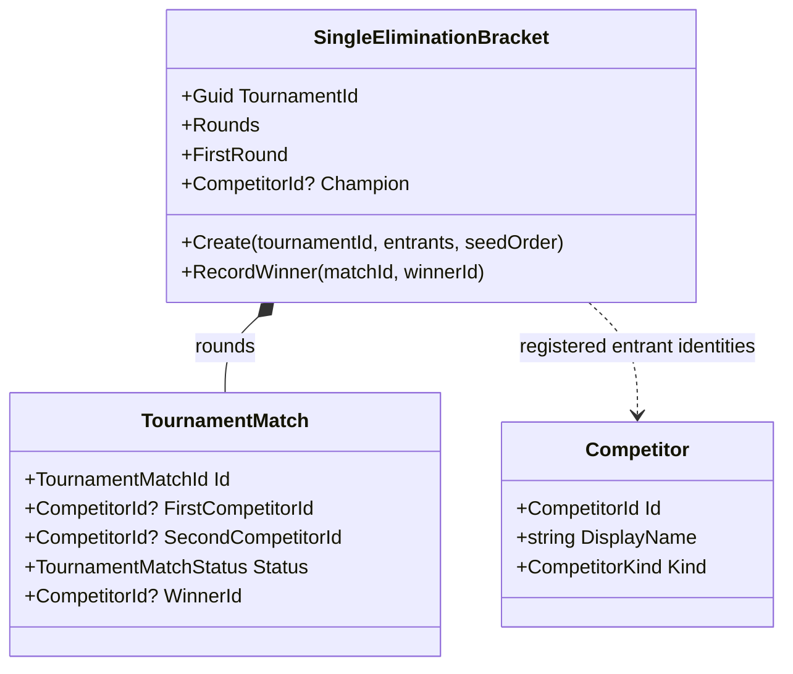
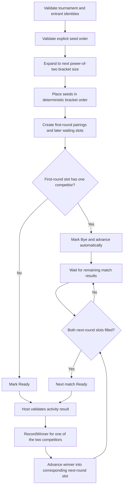

# Single-elimination tournament bracket

## 01 — What

SingleEliminationBracket creates a deterministic, immutable elimination bracket from a fixed entrant set and seed order. It generates power-of-two bracket slots, assigns standard seed pairings, grants automatic first-round byes, and advances only a competitor explicitly recorded as the winner of a ready match.

The bracket is an administration primitive. It does not decide who won a sport or game; the host validates the activity result and records the winner.

## 02 — Why

Tournament administration should not be reimplemented for every activity. A sports match, esports round, poker table, or blackjack round can all produce a validated winner. The bracket only needs competitor identities and progression rules.

Keeping the bracket deterministic makes it testable and replayable. Keeping it immutable means each recorded result creates a new snapshot rather than silently mutating an earlier bracket.

## 03 — How

### Type neighborhood



### Progression



### Invariants

- A bracket has at least two unique competitors.
- An explicit seed order must contain every entrant exactly once.
- The bracket size is the next power of two; unused seeds become first-round byes.
- Seed order determines pairings. The default is the supplied entrant order.
- A bye automatically advances its only competitor and cannot be manually resolved.
- A result can be recorded only for a Ready match with two competitors.
- The winner must be one of the match's competitors.
- A match can be completed only once.
- A result advances into the corresponding slot of the next round.
- The prior bracket snapshot remains unchanged after recording a result.

### Explicit maturity boundary

Implemented: deterministic single-elimination bracket creation, standard seeding order, first-round byes, immutable match snapshots, validated winner recording, and round advancement.

Not implemented: a full Tournament aggregate, scheduling/time slots, activity result validation, ties, withdrawals, disqualification, bracket correction/reopen, double elimination, Swiss, round robin, standings, persistence, distributed coordination, entry fees, or prize distribution.

## 04 — See it in a minute

```csharp
var bracket = SingleEliminationBracket.Create(
    tournamentId,
    registeredCompetitors,
    seededCompetitorIds);

var firstMatch = bracket.FirstRound[0];
// The host runs the match and validates its result.
var nextBracket = bracket.RecordWinner(firstMatch.Id, validatedWinnerId);
```

The bracket owns the progression rule, not the game. The caller must supply a winner that is supported by the activity's own result evidence.

## 05 — Choose your next step

- Add a Tournament aggregate that binds a competition registration snapshot to its bracket.
- Define result provenance and explicit tie, withdrawal, disqualification, and correction policies.
- Add round-robin scheduling and standings after the elimination contract is proven.
- Add persistence and recovery before multiplayer or crash-resilient tournament hosting.

<!-- THE SINGULARITY WORKSHOP FOOTER -->
<p align="center"></p>
