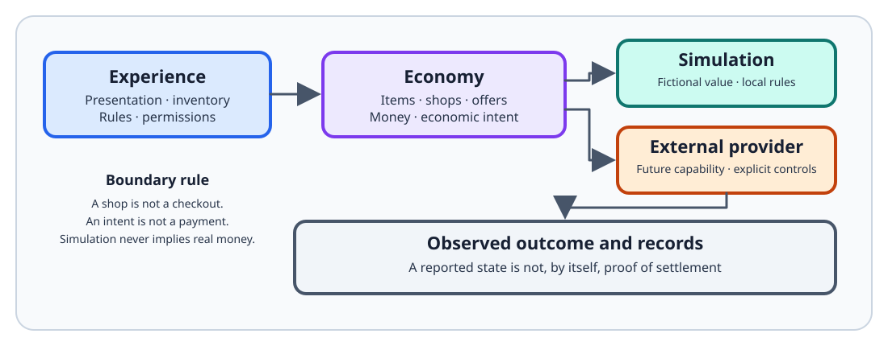

<!-- The Singularity Workshop moniker -->

# Economy — exchange made explainable

**Economy is an exploratory, provider-neutral domain for describing economic activity in simulated worlds and creator commerce.** It is not a bank, payment service, or production financial system.

  

## Start learning

- [Getting started](GETTING_STARTED.md) — create a shop with the current public API and understand its limits.
- [Theory learning path](THEORY/README.md) — study value, scarcity, exchange, incentives, currency, markets, labor, and simulation.
- [What is Economy?](WHAT_IS_ECONOMY.md) — understand the domain without starting from code.
- [Architecture](ARCHITECTURE.md) — see what exists, what is proposed, and where responsibilities belong.

## Explore the implementation

- [SimulationLedger API](API/SimulationLedger.md) — typed fictional currency, issuance, transfer, retirement, and derived balances.
- [SimulationLedger UML](UML/SimulationLedgerUML.md) — target-centered type neighborhood and use cases.
- [Gallery](GALLERY.md) — inspect the creator-shop composition proof and reproduce its tests.
- [Game store patterns](GAME_STORE_PATTERNS.md) — compose RPG, magic, consumable, crafting, and player markets without moving game rules into Economy.
- [Singularity currency and casino contract](SINGULARITY_CURRENCY_AND_CASINO.md) — the staged casino custody and wager model.
- [Simulated economies and creator commerce](SIMULATED_ECONOMIES_AND_CREATOR_COMMERCE.md) — the Singularity City direction and first Digiten loop.

## Verify claims

- [Documentation index](https://github.com/TrentBest/TheSingularityWorkshop.Economy/blob/development/DOCUMENTATION_INDEX.md) — map guides to source, tests, and workflows.
- [Domain tests](https://github.com/TrentBest/TheSingularityWorkshop.Economy/blob/development/tests/TheSingularityWorkshop.Economy.Tests/EconomyTests.cs).
- [Simulation ledger tests](https://github.com/TrentBest/TheSingularityWorkshop.Economy/blob/development/tests/TheSingularityWorkshop.Economy.Tests/SimulationLedgerTests.cs).
- [CI workflow](https://github.com/TrentBest/TheSingularityWorkshop.Economy/blob/development/.github/workflows/dotnet-tests.yml).

## Current maturity

The package is an exploratory alpha. Its process-local simulation ledger is useful for deterministic tests and in-process fictional-currency scenarios, but it is not durable, distributed, or a casino accounting system. Real-money operations remain a separate future capability requiring professional review and explicit authorization.

**Evidence rule:** implementation claims must point to source and tests; conceptual diagrams and future roadmaps are not proof that a capability is implemented.

<!-- THE SINGULARITY WORKSHOP FOOTER -->

